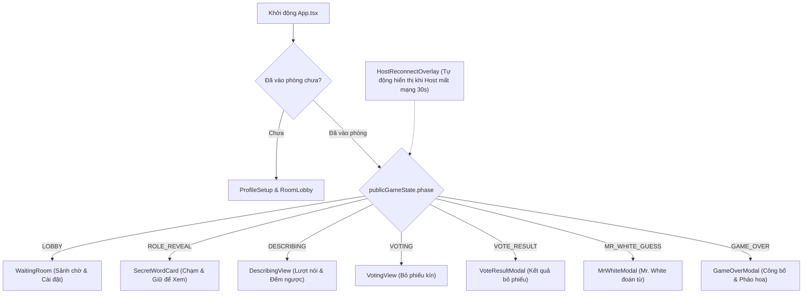

# Design Document: Mobile-First Web UI & Game Flow Interactions ("Ai Là Gián Điệp" - Phase 3)

- **Date:** 2026-10-10
- **Author:** Senior Fullstack Game Architect
- **Status:** Proposed
- **Target Tech Stack:** React 19, TypeScript (strict mode), TailwindCSS, Lucide-react, Canvas-confetti, Vite, Vitest

---

## 1. Mục tiêu & Định hướng thiết kế (Phase 3)

Phase 3 xây dựng toàn bộ giao diện web game hoàn chỉnh, kết nối trực tiếp với hook `useSpyRoom` từ Phase 2. Toàn bộ trải nghiệm được thiết kế theo tư duy **Mobile-First App** (tối ưu hóa khi mỗi người chơi cầm 1 smartphone, phòng từ 3 đến 10 người), giao diện sang trọng, kịch tính theo chủ đề trinh thám (Detective/Spy Mystery) và có cơ chế bảo vệ chống nhìn lén.

### Tiêu chí thành công cốt lõi:
1. **Detective Mystery Aesthetic:**
   - Gam màu chủ đạo: Nền tối sâu bí ẩn (`bg-slate-950`, `bg-slate-900`, `border-slate-800`).
   - Điểm nhấn: Vàng hổ phách trinh thám (`amber-400`), Xanh neon công nghệ (`cyan-400`), Đỏ cảnh báo nguy hiểm (`rose-500`), Xanh lục an toàn (`emerald-400`).
2. **Mobile UX Chuẩn Native:**
   - Layout đóng khung màn hình di động `max-w-md mx-auto min-h-[100dvh] flex flex-col`.
   - Chống zoom màn hình ngoài ý muốn (`touch-action: manipulation`).
   - Rung phản hồi nhẹ (Haptic feedback qua `navigator.vibrate`) khi chạm giữ hoặc bấm nút quan trọng.
3. **Cơ chế Chống Nhìn Lén (Anti-Peeking):**
   - Màn hình xem từ khóa dùng cơ chế **"Chạm và Giữ để Xem" (Press & Hold to Reveal)**. Buông tay ra là từ khóa lập tức ẩn đi sau lớp bảo mật mờ.
4. **State-Driven Single Page Flow:**
   - Chuyển cảnh tức thì theo `publicGameState.phase` không cần reload hay chuyển URL.
5. **Hybrid Supabase Client:**
   - Tự động dùng Supabase thật nếu có `.env`; nếu không có thì tự động fallback sang `BroadcastChannel` đa tab để test chơi thử ngay lập tức.
6. **Code Quality:**
   - 0 lỗi TypeScript strict mode, build bundle thành công với Vite, unit tests cho UI component đạt 100% pass.

---

## 2. Cấu trúc Component & Luồng Màn Hình

---

## 3. Chi tiết Từng Màn Hình

### 3.1. Profile Setup & Room Lobby (`src/client/components/Lobby/`)
- `ProfileSetup.tsx`:
  - Chọn 1 trong 8 avatar Mật vụ ngộ nghĩnh: 🦊 Fox, 🐱 Cat, 🦉 Owl, 🐺 Wolf, 🐼 Panda, 🦁 Lion, 🐰 Bunny, 🐸 Frog.
  - Ô nhập Nickname (2-16 ký tự).
  - Lưu vào `localStorage` để không phải nhập lại.
- `RoomLobby.tsx`:
  - Chuyển đổi giữa 2 tab:
    * **Tạo phòng mới:** Tự động sinh mã phòng 6 ký tự (ví dụ: `SPY888`).
    * **Vào phòng:** Ô nhập mã phòng 6 ký tự (tự động viết hoa, format `font-mono tracking-widest`).

### 3.2. Sảnh Chờ (`src/client/components/Lobby/WaitingRoom.tsx`)
- Thẻ mã phòng nổi bật kèm nút "Sao chép mã phòng" (`copyToClipboard`).
- Grid danh sách người chơi tham gia với avatar, tên, nhãn `Host` và trạng thái kết nối.
- Bảng cài đặt luật chơi (chỉ Host chỉnh được):
  * Số lượng Gián điệp: `1` (bàn 3-6 người) hoặc `2` (bàn 6-10 người).
  * Kẻ trắng tay (Mr. White): Toggle bật / tắt.
- Nút hành động:
  * Host: Nút to sáng màu `amber-400` "Bắt đầu ván đấu" (sáng khi phòng có 3-10 người).
  * Guest: Trạng thái "Đang đợi Host bắt đầu ván...".
  * Nút "Rời phòng".

### 3.3. Xem Từ Khóa Bí Mật (`src/client/components/Game/SecretWordCard.tsx`)
- Hiệu ứng phong bì mật thư đóng dấu "TOP SECRET".
- Khung "CHẠM VÀ GIỮ ĐỂ XEM TỪ KHÓA":
  - Sự kiện `onPointerDown`: Kích hoạt rung haptic (40ms), mở phong bì, hiện vai trò và từ khóa to rõ.
  - Sự kiện `onPointerUp` / `onPointerLeave`: Lập tức ẩn từ khóa và đóng lớp bảo mật.
  - Nếu là `MR_WHITE`: Hiển thị thông điệp đặc biệt "Bạn là Mr. White - Bạn KHÔNG có từ khóa! Hãy lắng nghe các người chơi khác mô tả và cố gắng đoán từ khóa của họ!".
- Nút "Tôi đã nhớ từ khóa! Sẵn sàng" để đánh dấu sẵn sàng vào vòng mô tả.

### 3.4. Vòng Mô Tả (`src/client/components/Game/DescribingView.tsx`)
- Chỉ báo vòng chơi: `Round X`.
- Danh sách người chơi còn sống sắp xếp theo thứ tự mô tả:
  - Người đang tới lượt nói có viền phát sáng động (`animate-pulse shadow-amber-500/50`).
  - Người đã nói xong có icon checkmark `emerald-400`.
- Thanh đếm ngược thời gian lượt nói (60s).
- Nếu người dùng chính là người đang có lượt:
  - Nút bấm to màu `cyan-400` "ĐÃ NÓI XONG / CHUYỂN LƯỢT" (`nextTurn()`).
  - Rung haptic khi bấm.
- Nút bấm xem lại từ khóa bí mật thu nhỏ ở góc màn hình (vẫn dùng cơ chế chạm giữ để xem an toàn).

### 3.5. Bỏ Phiếu Kín & Kết Quả (`src/client/components/Game/VotingView.tsx`)
- Danh sách thẻ người chơi còn sống để click chọn nghi phạm.
- Nút xác nhận: "Bỏ phiếu xử loại [Tên Người Chơi]" (`castVote(targetId)`).
- Trạng thái tiến độ bỏ phiếu: Chỉ báo số người đã vote xong `X/Y` (giữ bí mật mục tiêu vote cho đến khi công bố).
- **Vote Result Modal**:
  - Bảng tổng kết số phiếu của từng người.
  - Trường hợp Hòa phiếu: Banner vàng `HÒA PHIẾU! Không ai bị trục xuất` $\to$ Nút "Bắt đầu Round tiếp theo".
  - Trường hợp Đa số: Hiệu ứng đóng dấu đỏ `TRỤC XUẤT` lên người bị loại nhiều nhất.

### 3.6. Mr. White Guess & Game Over Modals
- `MrWhiteModal.tsx`:
  - Hiển thị khi Mr. White bị loại.
  - Với Mr. White: Ô nhập từ khóa đoán + Nút "Xác nhận đoán từ" (`submitMrWhiteGuess(guess)`).
  - Với các người chơi khác: Modal chờ với spinner "Mr. White đang đoán từ khóa...".
- `GameOverModal.tsx`:
  - Banner chiến thắng:
    * `CIVILIANS`: "DÂN THƯỜNG THẮNG CUỘC!" (màu `emerald-400`).
    * `SPIES`: "GIÁN ĐIỆP THẮNG CUỘC!" (màu `rose-500`).
    * `MR_WHITE`: "MR. WHITE LẬT KÈO CHIẾN THẮNG!" (màu `amber-400`).
  - Bắn pháo hoa ăn mừng bằng `canvas-confetti`.
  - Bảng lật mở toàn bộ bí mật: Danh sách người chơi kèm Avatar, Tên, Vai trò (`CIVILIAN`, `SPY`, `MR_WHITE`) và Từ khóa thật của từng người.
  - Nút "Chơi ván mới" (quay lại Lobby).

### 3.7. Host Reconnect Banner / Overlay
- Khi `isPausedForHostReconnect === true`:
- Lớp phủ mờ toàn màn hình hiển thị đồng hồ đếm ngược: "Host đang mất kết nối! Tạm dừng ván đấu [30s còn lại]...".

---

## 4. Hybrid Supabase Client Provider (`src/client/network/supabaseClient.ts`)

- Kiểm tra `import.meta.env.VITE_SUPABASE_URL` và `import.meta.env.VITE_SUPABASE_ANON_KEY`.
- Nếu có key: Sử dụng `createClient(url, key)`.
- Nếu thiếu key: Sử dụng `createBroadcastChannelSupabaseClient()` kết nối qua API `window.BroadcastChannel` trên trình duyệt để nhiều tab hoặc cửa sổ ẩn danh cùng máy đồng bộ realtime mà không cần backend Supabase!

---

## 5. Chiến lược Kiểm thử UI (Vitest + Happy-DOM)

- Cài đặt `happy-dom` để kiểm thử component trong Vitest.
- `SecretWordCard.test.tsx`: Kiểm tra từ khóa chỉ hiện khi pointerDown và lập tức biến mất khi pointerUp.
- `VotingView.test.tsx`: Kiểm tra chọn nghi phạm và gọi `castVote`.
- `WaitingRoom.test.tsx`: Kiểm tra hiển thị danh sách người chơi, nút Start Game chỉ active khi đủ người.
