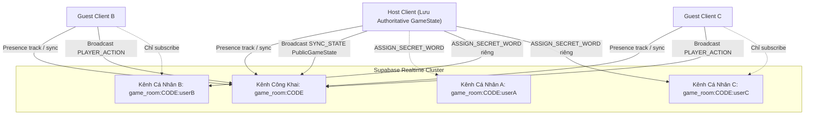

# Design Document: Realtime Network & Dual-Channel Secret Distribution ("Ai Là Gián Điệp" - Phase 2)

- **Date:** 2026-10-10
- **Author:** Senior Fullstack Game Architect
- **Status:** Proposed
- **Target Tech Stack:** TypeScript (strict mode), Supabase Realtime (Broadcast & Presence), React (`useSyncExternalStore`), Vitest

---

## 1. Mục tiêu & Phạm vi (Phase 2)

Phase 2 thiết lập toàn bộ tầng mạng Serverless Multiplayer (Host-Authority Hybrid) trên nền tảng Supabase Realtime kết nối trực tiếp với Pure Core Game Engine đã hoàn thiện ở Phase 1.

### Tiêu chí thành công cốt lõi:
1. **Zero-Knowledge Secret Distribution:** Từ khóa bí mật và vai trò của từng người chơi TUYỆT ĐỐI không bao giờ phát tán trên kênh công khai (`game_room:<roomCode>`). Mỗi người chơi chỉ nhận thông tin mật của riêng mình qua kênh cá nhân (`game_room:<roomCode>:<userId>`).
2. **Serverless Host-Authority Architecture:**
   - Host (người tạo phòng) lưu trữ `rawGameState: GameState` đầy đủ trong bộ nhớ và thực thi các pure transitions từ `src/core/game.ts`.
   - Các Guest (Peers) chỉ nhận `PublicGameState` đã lọc bỏ bí mật và gửi hành động (`PLAYER_ACTION`) về Host để Host thẩm định.
3. **Grace Period Reconnect (30s) & Host Migration:**
   - Trong `LOBBY`: Host rời phòng $\to$ Quyền Host tự động chuyển giao tức thì (`HOST_CLAIM`) cho người chơi có `joinedAt` sớm nhất.
   - Trong `ACTIVE GAME`: Host mất kết nối $\to$ Tạm dừng ván đấu (`isPausedForHostReconnect = true`) đếm ngược 30 giây. Nếu Host vào lại kịp thì khôi phục trận; nếu quá 30s thì hủy ván (`ABORTED`), chuyển quyền Host và đưa phòng về `LOBBY`.
4. **Headless Room Controller & React Hook:**
   - `SpyRoomController` thuần TypeScript, hỗ trợ Observer/Subscriber pattern tương thích trực tiếp với `useSyncExternalStore`.
   - React Hook `useSpyRoom` bao bọc bên ngoài mượt mà, tiện lợi cho UI Phase 3.
5. **Bộ Test Suite 100% Pass với In-Memory Mock Supabase:**
   - Chạy trực tiếp trong Node.js, không cần DOM giả lập, kiểm chứng bảo mật Zero-Knowledge và tính chịu lỗi mạng.

---

## 2. Kiến trúc Kênh Kép (Dual-Channel Architecture)



### 2.1. Kênh Công Khai (`game_room:<roomCode>`)
- **Presence:** Đồng bộ danh sách người chơi trong phòng:
  ```typescript
  export interface PlayerPresence {
    id: string;
    name: string;
    avatar: string;
    isHost: boolean;
    isReady: boolean;
    joinedAt: number; // Unix timestamp
    isAlive: boolean;
  }
  ```
- **Broadcast Events:**
  - `SYNC_STATE`: Host phát `PublicGameState` cho tất cả mọi người.
  - `PLAYER_ACTION`: Guest gửi hành động đến Host (`NEXT_DESCRIBE`, `SUBMIT_VOTE`, `MR_WHITE_GUESS`, `PROCEED_ROUND`).
  - `HOST_CLAIM`: Thông báo nhận quyền Host mới khi Host cũ rời phòng ở Lobby hoặc sau khi hết thời gian tạm dừng.
  - `HOST_STATUS`: Thông báo trạng thái kết nối của Host (`isConnected`, `graceExpiresAt`).

### 2.2. Kênh Cá Nhân (`game_room:<roomCode>:<userId>`)
- Chỉ có đúng 2 bên tham gia: **Host** (gửi) và **User đó** (nhận).
- **Broadcast Event:**
  - `ASSIGN_SECRET_WORD`:
    ```typescript
    export interface SecretWordPayload {
      role: Role;
      word: string;
    }
    ```
- Các người chơi khác không subscribe vào kênh này nên DevTools của họ hoàn toàn không nhận được gói tin này.

---

## 3. Data Models cho Mạng (`src/client/network/types.ts`)

```typescript
import type { Role, GamePhase, GameWinner, VoteResult, GameConfig } from '../../core/types.js';

export interface PlayerPresence {
  id: string;
  name: string;
  avatar: string;
  isHost: boolean;
  isReady: boolean;
  joinedAt: number;
  isAlive: boolean;
}

export interface PublicPlayerState {
  id: string;
  name: string;
  avatar: string;
  isAlive: boolean;
  hasVoted: boolean;
  // Chỉ xuất hiện khi phase === 'GAME_OVER'
  revealedRole?: Role;
  revealedWord?: string;
}

export interface PublicGameState {
  roomCode: string;
  phase: GamePhase;
  roundNumber: number;
  currentDescriberIndex: number;
  players: PublicPlayerState[];
  winner: GameWinner;
  lastVoteResult: VoteResult | null;
  isPausedForHostReconnect: boolean;
  hostReconnectSecondsRemaining: number;
}

export interface SecretWordPayload {
  role: Role;
  word: string;
}

export type PlayerAction =
  | { type: 'START_GAME'; config: GameConfig }
  | { type: 'NEXT_DESCRIBE'; playerId: string }
  | { type: 'SUBMIT_VOTE'; voterId: string; targetId: string }
  | { type: 'MR_WHITE_GUESS'; playerId: string; guess: string }
  | { type: 'PROCEED_ROUND'; playerId: string };

export interface RoomStateSnapshot {
  roomCode: string;
  localPlayerId: string;
  localPlayerName: string;
  isHost: boolean;
  isConnected: boolean;
  presenceList: PlayerPresence[];
  publicGameState: PublicGameState | null;
  mySecret: SecretWordPayload | null;
  error: string | null;
}
```

---

## 4. Headless Room Controller (`src/client/network/SpyRoomController.ts`)

Class `SpyRoomController` quản lý toàn bộ vòng đời mạng và state:

### 4.1. Khởi tạo & Kênh kép
- Nhận `supabase: SupabaseClient` (hoặc mock) và thông tin `localPlayer: { id, name, avatar }`.
- Phương thức `joinRoom(roomCode: string)`:
  - Khởi tạo `publicChannel = supabase.channel(`game_room:${roomCode}`)`.
  - Khởi tạo `privateChannel = supabase.channel(`game_room:${roomCode}:${localPlayer.id}`)`.
  - Subscribe presence và broadcast handlers.
  - Track bản thân lên Presence.
  - Subscribe private channel để nhận `ASSIGN_SECRET_WORD`.

### 4.2. Host Authority Execution
- Lưu trữ `rawGameState: GameState | null`.
- `toPublicGameState(state: GameState, presences: PlayerPresence[], isPaused = false, remaining = 0): PublicGameState`:
  - Chuyển đổi `state.players` sang `PublicPlayerState[]`:
    * Trong quá trình chơi: bỏ `role` và `word`.
    * Khi `state.phase === 'GAME_OVER'`: gắn `revealedRole: p.role`, `revealedWord: p.word`.
- Khi Host bắt đầu game (`startGame(config)`):
  - Lấy danh sách người chơi từ Presence.
  - Tạo game bằng `createInitialGame`, chọn từ khóa ngẫu nhiên từ `WORD_PAIRS`.
  - Thực thi `assignRolesAndWords`.
  - Duyệt từng người chơi:
    * Với mỗi `p`: gửi `ASSIGN_SECRET_WORD` với `{ role: p.role, word: p.word }` vào `game_room:${roomCode}:${p.id}`.
    * Với chính Host: gán thẳng vào `mySecret`.
  - Tạo `publicGameState` và broadcast `SYNC_STATE` lên kênh chung.
- Khi Host nhận `PLAYER_ACTION`:
  - Kiểm tra tính hợp lệ (ví dụ: người yêu cầu phải đúng lượt, người vote phải còn sống).
  - Áp dụng hàm thuần từ `src/core/game.ts`:
    * `NEXT_DESCRIBE` $\to$ `nextTurn(rawGameState)`
    * `SUBMIT_VOTE` $\to$ `castVote(rawGameState, voterId, targetId)`. Nếu toàn bộ người sống đã vote, tự động gọi `tallyVotes`.
    * `MR_WHITE_GUESS` $\to$ `submitMrWhiteGuess(rawGameState, playerId, guess)`.
    * `PROCEED_ROUND` $\to$ `proceedToNextRound(rawGameState)`.
  - Cập nhật `rawGameState` và broadcast `SYNC_STATE`.

### 4.3. Presence & Host Migration
- **Bầu Host ban đầu:** Người chơi có `joinedAt` sớm nhất trong danh sách presence (hoặc người tạo phòng).
- **Khi Host ngắt kết nối (Presence leave):**
  - **Trường hợp LOBBY:**
    * Tìm người chơi có `joinedAt` sớm nhất còn lại trong presence.
    * Người đó tự claim host (`HOST_CLAIM`), chuyển `isHost = true`, phát lại presence với `isHost: true`.
  - **Trường hợp ACTIVE GAME (đang trong ván):**
    * Bật cờ `isPausedForHostReconnect = true`, đếm ngược 30s.
    * Broadcast `HOST_STATUS` lên kênh chung để mọi client hiển thị modal chờ Host.
    * Nếu Host vào lại trong 30s: Host phát lại `SYNC_STATE` hiện tại kèm `isPausedForHostReconnect = false`, tiếp tục trận đấu.
    * Nếu hết 30s không vào lại: Hủy ván đấu (`phase = 'LOBBY'`), chuyển quyền Host cho người có `joinedAt` sớm nhất, đưa toàn bộ client về phòng chờ LOBBY.

### 4.4. Observer/Subscriber Pattern
- `subscribe(listener: () => void): () => void`: Đăng ký callback khi snapshot thay đổi.
- `getSnapshot(): RoomStateSnapshot`: Trả về immutable snapshot hiện tại.

---

## 5. React Hook Wrapper (`src/client/hooks/useSpyRoom.ts`)

```typescript
import { useSyncExternalStore, useMemo } from 'react';
import { SpyRoomController } from '../network/SpyRoomController.js';

export function useSpyRoom(controller: SpyRoomController) {
  const snapshot = useSyncExternalStore(
    controller.subscribe,
    controller.getSnapshot
  );

  return {
    ...snapshot,
    startGame: controller.startGame.bind(controller),
    nextTurn: controller.nextTurn.bind(controller),
    castVote: controller.castVote.bind(controller),
    submitMrWhiteGuess: controller.submitMrWhiteGuess.bind(controller),
    proceedToNextRound: controller.proceedToNextRound.bind(controller),
    leaveRoom: controller.leaveRoom.bind(controller),
  };
}
```

---

## 6. Chiến lược Kiểm thử (Vitest Mock Network Suite)

Tạo mock Supabase Realtime in-memory (`tests/client/mockSupabase.ts`):
- Giả lập channel Hub đa client kết nối chung bộ nhớ (in-process event bus).
- Hỗ trợ đầy đủ: `channel()`, `subscribe()`, `send()`, `track()`, `untrack()`.

### Các file test trong `tests/client/`:
1. `tests/client/dualChannelSecurity.test.ts`:
   - Kiểm tra gán từ khóa Zero-Knowledge: 4 client (Host + 3 Guest).
   - Kiểm tra nhật ký broadcast của kênh chung `game_room:CODE`: **100% không chứa bất kỳ từ khóa hay vai trò bí mật nào**.
   - Kiểm tra mỗi client chỉ nhận đúng từ khóa của mình trên kênh cá nhân.
2. `tests/client/hostAuthority.test.ts`:
   - Guest gửi `PLAYER_ACTION` $\to$ Host nhận và cập nhật state $\to$ Toàn bộ client nhận `SYNC_STATE` mới.
   - Host chặn hành động bất hợp lệ (ví dụ: Guest không trong lượt cố tình bấm next, người chết cố tình vote).
3. `tests/client/hostMigration.test.ts`:
   - Test Host rời phòng trong LOBBY: Guest đầu tiên tự động thành Host mới.
   - Test Host ngắt kết nối trong ACTIVE GAME: Phòng kích hoạt 30s tạm dừng; Host vào lại thì resume, Host bỏ hẳn thì hủy game về Lobby.
4. `tests/client/useSpyRoom.test.ts`:
   - Test đăng ký snapshot qua `useSyncExternalStore` và gọi action thành công.
